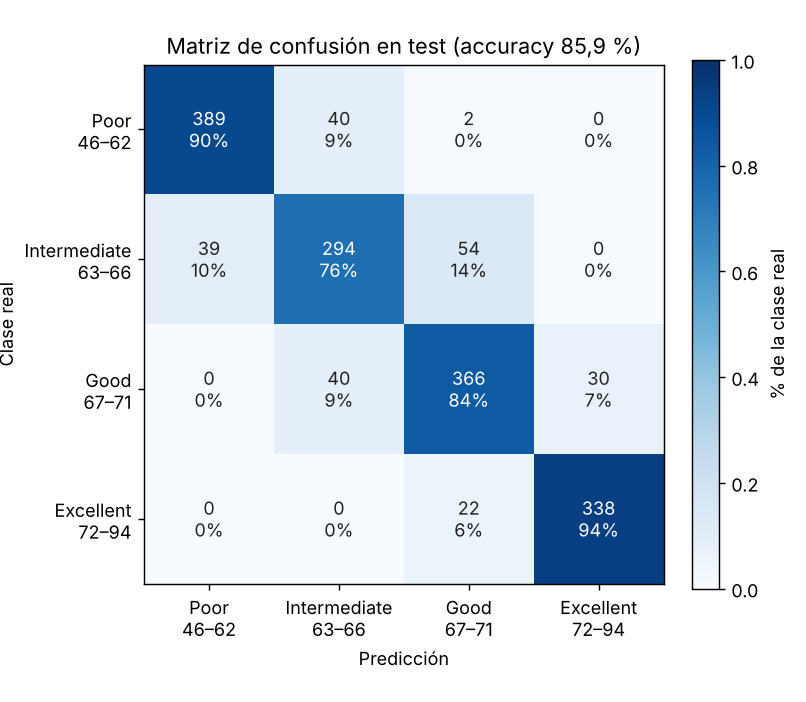
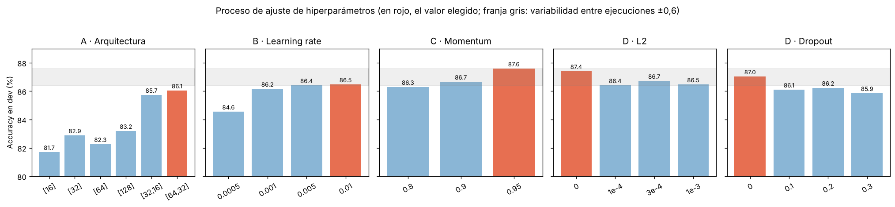
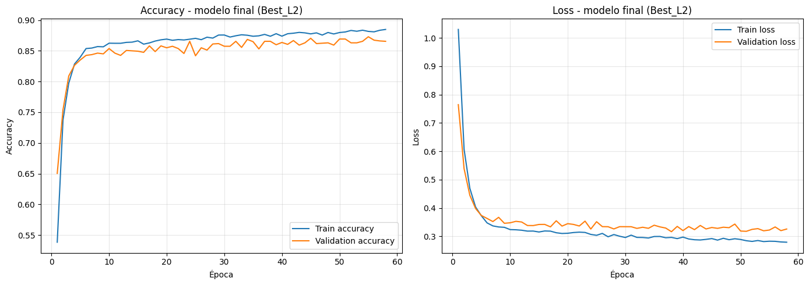
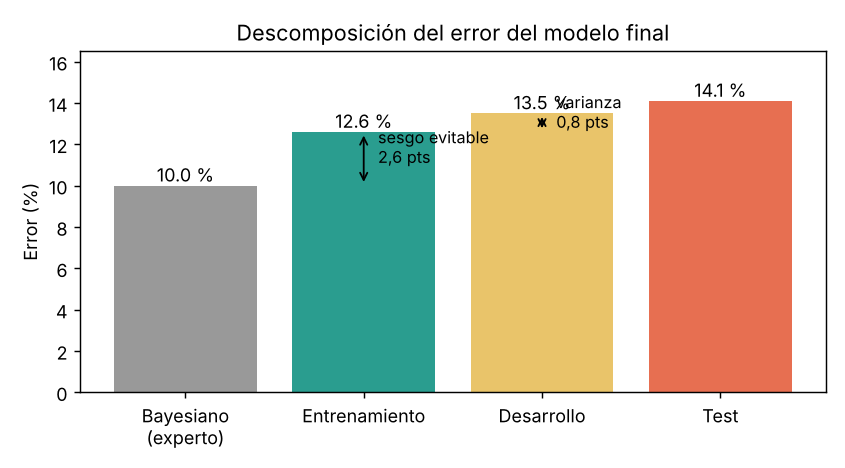

# ⚽ Red neuronal para estimar la calidad de un jugador de fútbol

Red neuronal profunda en **TensorFlow / Keras**, entrenada con **SGD + momentum**, que clasifica a los jugadores de FIFA 19 en 4 niveles de calidad (*Poor, Intermediate, Good, Excellent*) a partir de 22 habilidades. El proyecto sigue un **proceso de diseño sistemático**, ajustando un hiperparámetro en cada fase, y analiza el resultado en términos de **sesgo y varianza** respecto al error de un experto humano.


> Práctica de la asignatura **Aprendizaje Automático II** (Grado en Ciencia de Datos e Inteligencia Artificial, UPM · curso 2025-26), realizada en grupo.

**👉 [Ver el notebook completo](notebooks/red_neuronal_sgd_momentum.ipynb)**

---

## Resultados

| | |
|---|---|
| **Accuracy en test** | **85,9 %** (1.614 jugadores que no se usaron en el diseño) |
| Red final | 22 → Dense(64, ReLU) → Dense(32, ReLU) → Dense(4, softmax) |
| Optimizador | SGD, `learning rate = 0.01`, `momentum = 0.95`, `batch size = 128` |
| Regularización | Ninguna, más *early stopping* (paciencia 20, restaura los mejores pesos) |
| Referencia | Error bayesiano del 10 % (ojeador experto) → techo de ≈90 % |



- **De los 227 errores, 225 son entre clases contiguas.** El modelo ha aprendido el orden de las categorías y nunca confunde, por ejemplo, un jugador Excellent con uno Poor.
- **Intermediate es la clase más difícil** (recall 76 %): solo abarca 4 puntos de *overall* (63–66) y limita con dos clases.

## Proceso de diseño

Los hiperparámetros se ajustan **uno a uno**, fijando en cada fase el mejor valor de la anterior. Todas las decisiones se toman con el conjunto de **desarrollo** (10 %), y el de **test** (10 %) se usa una única vez al final.



| Fase | Qué se prueba | Conclusión |
|---|---|---|
| **A · Arquitectura** | 6 redes de 1 y 2 capas ocultas | 2 capas ([64, 32]) superan a cualquier red de 1 capa. La profundidad importa más que la anchura |
| **B · Learning rate** | 0.0005 – 0.01 | `0.01` converge en 62 épocas frente a 300, con la misma precisión |
| **C · Momentum** | 0.8, 0.9, 0.95 | `0.95` da la mejor *accuracy* en dev (87,6 %) |
| **D · Regularización** | L2 y *dropout* | Ninguna mejora: el modelo **no sobreajusta** |



## Análisis de sesgo y varianza



El error de entrenamiento (12,6 %) está 2,6 puntos por encima del error bayesiano, mientras que la diferencia entre entrenamiento y desarrollo es de solo 0,8 puntos. **El problema dominante es el sesgo**, no la varianza. Esto explica por qué la regularización no ayudó, y apunta a que los siguientes pasos serían **más capacidad** (más neuronas o capas) o **más entrenamiento**, no más regularización.

## Una lección metodológica: la variabilidad entre ejecuciones

Durante el proceso, **la misma configuración** se entrenó 5 veces en fases distintas. Su *accuracy* en desarrollo varió entre el 86,2 % y el 87,6 % (**0,870 ± 0,006**) solo por la aleatoriedad de la inicialización de los pesos y del orden de los *mini-batches*. Esa variación es del mismo orden que varias de las diferencias usadas para elegir hiperparámetros, como `lr = 0.01` frente a `0.005`, que solo difieren en 0,06 puntos.

Las decisiones con diferencias grandes siguen siendo válidas. Aun así, la conclusión es clara: para comparar modelos con rigor hay que **fijar la semilla y promediar varias ejecuciones** por configuración. Es la principal mejora que aplicaría al repetir el proyecto.

## Datos

[FIFA 19 Complete Player Dataset](https://www.kaggle.com/datasets/javagarm/fifa-19-complete-player-dataset) (Kaggle). Tras la limpieza quedan **16.134 jugadores** con 22 atributos que tienen una correlación superior a |0,3| con el *overall*, como reacciones, compostura, pase corto o control de balón. La variable objetivo se discretiza en sus 4 cuartiles.

## Estructura del repositorio

```
├── notebooks/
│   ├── preparacion_datos.ipynb          # Limpieza y preparación (proporcionado por la asignatura)
│   ├── red_neuronal_sgd_momentum.ipynb  # Diseño, entrenamiento y evaluación de la red
│   └── my_callbacks.py                  # Callbacks auxiliares de Keras (barra de progreso, etc.)
├── data/
│   ├── FootballPlayerRawDataset.csv               # Datos originales (18.207 jugadores, 89 variables)
│   ├── FootballPlayerPreparedCleanAttributes.csv  # 22 atributos limpios
│   └── FootballPlayerOneHotEncodedClasses.csv     # Clase de calidad en one-hot
├── docs/img/                            # Figuras del README
└── requirements.txt
```

## Cómo ejecutarlo

```bash
git clone https://github.com/antiasande/football-player-quality-nn.git
cd football-player-quality-nn
pip install -r requirements.txt
jupyter notebook notebooks/red_neuronal_sgd_momentum.ipynb
```

Entrenar todos los experimentos lleva unos 15 minutos en CPU. Como no se fijó la semilla, los valores exactos variarán ligeramente en cada ejecución (ver la sección anterior).

## Autoría

Proyecto en grupo para Aprendizaje Automático II (UPM):

- **Antía Sande Fernández** · [GitHub](https://github.com/antiasande)
- *[Compañero/a 2]*
- *[Compañero/a 3]*
- *[Compañero/a 4]*

## Tecnologías

Python · TensorFlow · Keras · scikit-learn · pandas · NumPy · Matplotlib
